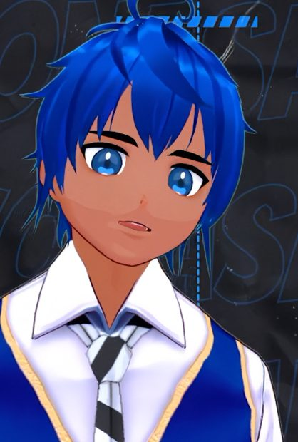
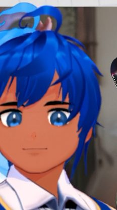

# Remover de Fundos

**Ferramenta grátis que remove o fundo de imagens direto no navegador.**
Sem cadastro · Sem upload · Suas imagens nunca saem do seu dispositivo

Criada por [**Yonasan**](https://www.youtube.com/@YonasanErihhi/)

### [👉 Abrir a ferramenta](https://yonasanerihhi.github.io/yonasan-removedor-de-fundos/)

---

## ✨ O que dá para fazer

- **Modo Automático:** detecta o fundo sozinho, inclusive o *xadrez falso* de PNG
- **Selecionar fundo:** você toca nas cores que quer remover
- **Estúdio:** varinha mágica, pincel de apagar e restaurar, recorte e refinamento de bordas
- **Várias imagens de uma vez:** baixe separadas ou em um ZIP
- **Fundo no download:** transparente ou cores sólidas (verde, branco, etc.)
- **Zoom:** botões ＋/− ou Ctrl + rolagem do mouse, com modo ✋ Mover para arrastar a imagem
- **Seletor de cor:** escolha a cor do fundo direto no seletor (além de clicar na imagem)
- **Histórico:** desfazer, refazer e resetar, além do botão 👁 para comparar com o original

## 🚀 Como usar

1. Arraste, cole (**Ctrl+V**) ou escolha uma ou várias imagens
2. Ajuste no modo que preferir (a tolerância resolve a maioria dos casos)
3. Baixe o PNG

## 🔒 Privacidade

- Todo o processamento acontece **no seu navegador**, usando Canvas
- Nenhuma imagem é enviada a servidor algum e nada é guardado
- Usamos Google Analytics (que pode usar cookies) apenas para medir acessos e cliques, sem acesso ao conteúdo das imagens
- Você pode subir imagens suas, de IA ou com licença/autorização. Os direitos de uso das imagens são de responsabilidade de quem as envia

Termos completos: botão **Termos de Uso** no rodapé da ferramenta e em [docs/documentacao.md](docs/documentacao.md).

---

## ❤️ Apoie o projeto

A ferramenta **é e continua grátis**. Se ela te poupou tempo, estas são as formas de ajudar a manter e criar mais ferramentas:

<table>
<tr>
<td width="200" align="center">

</td>
<td>
<h3>▶ Seja membro do canal</h3>

A partir de <b>R$&nbsp;3,99*</b> você apoia o canal e recebe a <b>versão desktop para Windows</b> (portátil, sem instalador), além de wallpapers, chat exclusivo e outros mimos.

<a href="https://www.youtube.com/@YonasanErihhi/join"><b>Virar membro →</b></a>

</td>
</tr>
<tr>
<td width="200" align="center">

</td>
<td>
<h3>☕ Pague um café</h3>

Qualquer valor via Pix ajuda a manter e criar <b>mais ferramentas grátis</b>. Totalmente opcional.

<a href="https://livepix.gg/yonasan"><b>Apoiar via LivePix →</b></a>

</td>
</tr>
</table>

\* Valor conferido em **24/10/2026** e sujeito a mudanças pelo YouTube ou pelo autor. Confira sempre o valor atual na página de membros do canal. Os benefícios também podem mudar com o tempo.

---

## 📺 Conheça o canal

- [YouTube – @YonasanErihhi](https://www.youtube.com/@YonasanErihhi/)
- [Redes sociais (Linktree)](https://linktr.ee/yonasan)

## 📄 Sobre o código

O código fica visível aqui, mas este projeto **não é open source livre** (MIT, Apache, etc.). O uso da ferramenta é liberado para processar suas imagens; copiar, redistribuir ou apresentar como produto próprio não é permitido sem autorização. Detalhes em [docs/documentacao.md](docs/documentacao.md).

**© Yonasan** · Uso pessoal e legítimo
